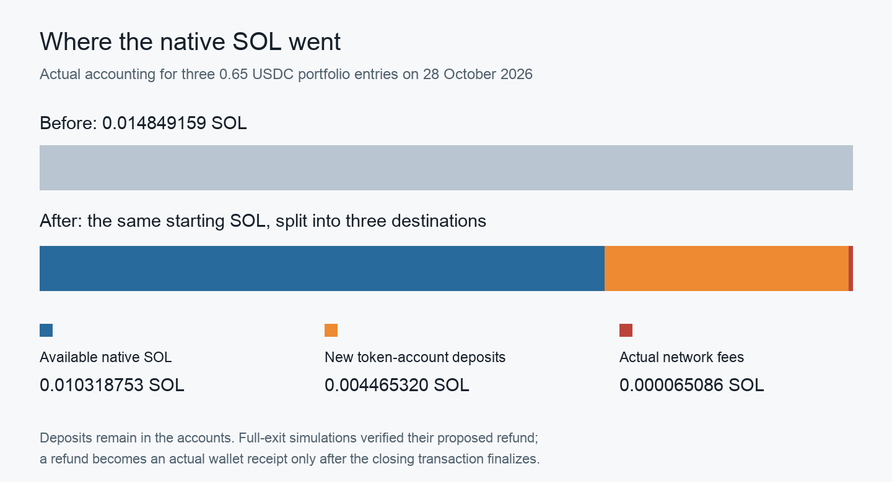
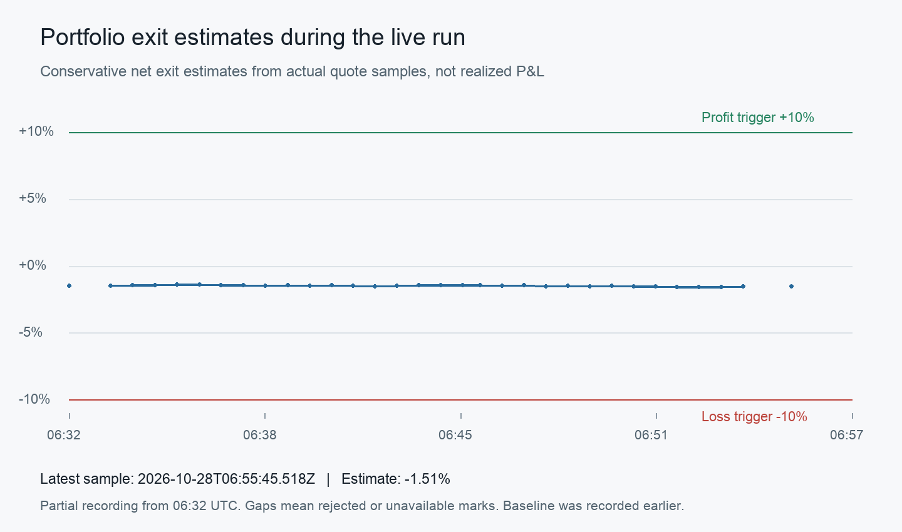

# A $3.66 Solana bot, Helius, and a 30-minute deadline

Buying a token takes one swap. Building a trading bot takes everything around that swap: choosing the right token, limiting what the wallet can spend, handling a missing response, and figuring out whether the balance on screen is money you can get back.

I tested this with a small mainnet wallet, Helius RPC, and Jupiter Swap V2. The starting portfolio for this experiment was worth about 3.66 USDC at its recorded quote prices. I allocated 0.65 USDC each to WETH, HYPE, and ZEC while retaining native SOL.

The original plan allowed 24 hours and a 10% loss trigger. After the purchases, I changed the target to a 10% gain and shortened the remaining test to 30 minutes, keeping the loss trigger at 10%. Those are instructions for the bot. They do not make the market move by 10%.

The original P&L baseline stays at 06:10:29.672 UTC. The revised deadline is 06:57:43 UTC, so the complete measured experiment spans about 47 minutes; only the amended remaining window is 30 minutes. Resetting the baseline when I changed the rules would erase the earlier part of the result.

The positions closed before the revised deadline. The ending portfolio's marked value was about 0.97% below the original baseline. This article follows the implementation and actual receipts, including the fees that contributed to that loss.

## Contents

- [What Helius does in this bot](#helius-role)
- [What is the strategy?](#strategy)
- [First, identify what the wallet is buying](#asset-identity)
- [Run the read-only commands first](#read-only-start)
- [Follow one purchase](#one-purchase)
- [Read the instruction you are about to sign](#instruction-bounds)
- [Simulate the wallet, including its SOL](#wallet-effects)
- [Where did the account deposit go?](#account-deposits)
- [Save the transaction before sending it](#durable-attempt)
- [Calculate the whole portfolio's return](#portfolio-return)
- [Make the deadline survive a broken quote](#exit-monitor)
- [What the real test has proved](#real-validation)
- [The result](#result)
- [Where an agent could fit](#agent)

<a id="helius-role" name="helius-role"></a>

## What Helius does in this bot

The application needs answers to several different questions. What does the wallet own? Which swap route is available? What would the instructions do to its accounts? Did the submitted transaction execute?

Jupiter supplies the route and swap instructions through its [Swap V2 API](https://developers.jup.ag/docs/swap). Helius supplies the chain reads, blockhash, simulations, priority-fee estimate, transaction submission, and settlement reads. The local application decides which exact assets and amounts are permitted.

| Question | Component used in this run |
|---|---|
| What does this wallet own? | Helius RPC account reads |
| How could this amount be swapped? | Jupiter `/swap/v2/build` |
| What would happen to the wallet? | Helius `simulateTransaction` |
| What priority fee should be considered? | Helius `getPriorityFeeEstimate` |
| Who signs? | A local wallet key outside the repository |
| Who submits and observes? | Helius RPC |
| What establishes a receipt? | Finalized transaction metadata and reconciled accounts |

The [Helius simulation API](https://www.helius.dev/docs/api-reference/rpc/http/simulatetransaction) returns execution logs, compute usage, and requested account effects without submitting a transaction. That makes it useful for preparation. It does not reserve the quoted price or prove a future fill.

This implementation uses ordinary RPC submission. I did not test Sender, LaserStream, preconfirmations, or webhooks in this run, so there is no measured claim about their latency or landing performance here.

<a id="strategy" name="strategy"></a>

## What is the strategy?

The trading rule is deliberately small: allocate a fixed amount to each approved asset, watch the combined portfolio, and close the positions when a configured threshold or time limit is reached.

It has no price-prediction model. It does not detect arbitrage, forecast order flow, or establish an advantage over someone buying the same basket manually. A profitable result could come from the market moving up during this particular window. Automation would explain how the orders were handled, not why that market move happened.

The three token entries together can spend at most 1.95 USDC. Each asset has a lifetime entry budget of 0.65 USDC for this run. Native SOL already existed in the wallet. The executor keeps a gas reserve rather than treating the entire native balance as sellable input.

The full policy also limits slippage to 50 basis points, absolute quoted price impact to 1%, priority fees to 50,000 lamports, and total network fees to 60,000 lamports per transaction. Those limits can cause a trade to be refused. Refusal is a valid execution result.

<a id="asset-identity" name="asset-identity"></a>

## First, identify what the wallet is buying

A symbol is a label. The Solana mint address identifies the token account's asset.

That distinction matters here because the wallet is on Solana while some requested assets originate elsewhere. The ETH position is Wormhole WETH. The HYPE position uses the Sunrise representation documented for Solana. The ZEC position is the Solana representation mapped by the NEAR OmniBridge registry; it is not a native Zcash balance with shielded transactions.

| Position | Decimals | Exact Solana mint used |
|---|---:|---|
| USDC | 6 | `EPjFWdd5AufqSSqeM2qN1xzybapC8G4wEGGkZwyTDt1v` |
| SOL API identifier | 9 | `So11111111111111111111111111111111111111112` |
| Wormhole WETH | 8 | `7vfCXTUXx5WJV5JADk17DUJ4ksgau7utNKj4b963voxs` |
| Sunrise HYPE | 9 | `98sMhvDwXj1RQi5c5Mndm3vPe9cBqPrbLaufMXFNMh5g` |
| OmniBridge ZEC | 8 | `A7bdiYdS5GjqGFtxf17ppRHtDKPkkRqbKtR27dxvQXaS` |

The SOL identifier is the wrapped SOL mint used by the swap interface. The wallet's retained SOL is native SOL. The preparation logic accounts for wrapping and closing the temporary token account on a native SOL exit. [Solana's Sync Native documentation](https://solana.com/docs/tokens/basics/sync-native) explains the relationship.

I checked the WETH mint against a [pinned Wormhole SDK registry](https://github.com/wormhole-foundation/wormhole-sdk-ts/blob/479df45f0a11684a13174189851c00e19b536a4a/core/base/src/constants/tokens/mainnet.ts), and the HYPE mint and authority against [Sunrise's asset documentation](https://docs.sunrise.xyz/resources/listed-assets.md). For ZEC, I queried the official NEAR bridge registry in both directions: the Solana mint mapped to `zec.omft.near`, and that token mapped back to the same Solana mint. The registry methods are visible in the [OmniBridge contract source](https://github.com/Near-One/omni-bridge/blob/main/near/omni-bridge/src/lib.rs).

The live executor then checks the selected mint's token program, decimals, expected mint authority, absence of a freeze authority, and absence of unreviewed extensions. A correct identity still carries the representation's bridge and redemption risks. I did not redeem these assets through their bridges. The trust models are described by [Wormhole](https://docs.wormhole.com/products/token-transfers/wrapped-token-transfers/overview/), [Sunrise](https://docs.sunrise.xyz/concepts/infrastructure-and-security.md), and [NEAR](https://docs.near.org/chain-abstraction/omnibridge/how-it-works).

<a id="read-only-start" name="read-only-start"></a>

## Run the read-only commands first

The tested runtime is Node 24.19.0 with `@solana/web3.js` 3.1.1 and `bs58` 6.0.0. The lockfile pins the dependency versions. Do not substitute older library examples without checking their APIs; the tested signing calls are asynchronous.

From the project directory, the inspection commands are:

```sh
npm ci
npm test
npm run balances
npm run portfolio:mark
npm run portfolio:prepare -- ETH
```

The RPC helper reads a private configuration file at `~/.local/share/helius-trading-bot/config.json`. Its minimal shape is `{ "heliusApiKey": "YOUR_KEY" }`. An optional Jupiter key can be supplied separately. The wallet secret and transaction journal also live outside the repository; the mark and preparation paths never load that signing secret.

This research copy is bound to its dedicated wallet and exact policy. Adapting it means reviewing the owner address, approved assets, baseline, limits, and recovery assumptions for your own wallet. Do not fund the article's example address. A build request or successful simulation does not authorize execution; the live command also requires the approved baseline and risk record.

<a id="one-purchase" name="one-purchase"></a>

## Follow one purchase

USDC has six decimal places in this implementation, so a 0.65 USDC input is `650_000n` base units. Monetary arithmetic uses `BigInt` throughout the policy and accounting modules.

The build request supplies the exact input and output mints, amount, wallet, slippage, and transaction version. This excerpt uses the project's HTTP helper:

```js
const build = await requestBuild({
  inputMint: USDC,
  outputMint: asset.mint,
  amount: '650000',
  taker: OWNER,
  slippageBps: '50',
  transactionVersion: '0',
});
```

The response proposes instructions. Before compiling them, the application checks the response's mints and exact amount against policy, then checks the encoded instruction itself. It obtains its own recent blockhash and last-valid block height from Helius rather than mixing unrelated lifetimes.

Preparation first simulates with a generous compute limit and zero priority price. The consumed units determine a limit with 20% headroom, subject to the policy maximum. The application then asks Helius for a transaction-scoped priority estimate. [Helius's fee documentation](https://www.helius.dev/docs/priority-fee-api) distinguishes estimates for the transaction's writable accounts from network-wide estimates.

The selected price never increases the spending cap to follow a recommendation. When a recommendation exceeds the cap, the application selects a lower price within budget and simulates the final message again. That can reduce the chance of landing; the report preserves both the recommended and selected prices.

<a id="instruction-bounds" name="instruction-bounds"></a>

## Read the instruction you are about to sign

Checking `build.inAmount` alone leaves a gap. The wallet signs instruction bytes, while `inAmount` is a field in an API response. The two must agree.

The decoder checks the Jupiter program, instruction format, encoded input and quoted output, slippage, fees, source account, destination account, mint accounts, token programs, and required signer. It accepts the reviewed V2 exact-input layouts and rejects unknown formats. It also rejects an unrelated owned token account being writable in the swap.

The local minimum deserves a precise definition. At 50 basis points of slippage, the decoder uses `floor(quotedOutput × 9950 / 10000)` as its conservative bound for simulation and settlement. It separately requires the API's threshold field to match the corresponding ceiling. The two can differ by one atomic token unit. I verified the encoded quote terms, but did not independently prove the running program's exact rounding implementation; the local floor is an explicitly conservative accounting choice.

Two layouts appeared during preparation. Some routes used `route_v2`; a captured HYPE route used `shared_accounts_route_v2`. The latter required checking the program authority and program-owned token accounts too. Their derivation follows Jupiter's [public authority seed implementation](https://github.com/jup-ag/jupiter-amm-implementation/blob/main/jupiter/src/lib.rs).

For the V2 schema, I fetched Jupiter's live Anchor IDL from its on-chain account at a recorded finalized slot. A repository IDL was insufficient for the newer layouts encountered in actual responses. The decoder pins the schema it reviewed and fails on unrecognized enum tags.

Lookup tables need a separate check. The build response supplies addresses for transaction compilation, but the chain resolves the actual lookup table. The preparation code fetches the active on-chain tables and compares the indexes before treating that mapping as reviewed.

This is still a targeted boundary check. It is not an audit of Jupiter's implementation, every downstream exchange program, or program upgrade controls.

<a id="wallet-effects" name="wallet-effects"></a>

## Simulate the wallet, including its SOL

A successful simulation can still describe the wrong transaction. The application asks for the wallet and relevant token accounts in the simulation result, then checks their actual changes.

For an entry, USDC must fall by exactly 650,000 base units. The expected asset account must receive at least the checked minimum. Every inspected token account must retain the expected owner, initialized state, and authority settings. Unrelated token balances and account closures must remain unchanged.

The native SOL debit needs an explanation too:

```js
if (beforeSol - afterSol !== networkFee + newTokenAccountDeposit) {
  throw Error('Unexplained native SOL movement');
}
```

That equality applies to this entry path. Token exits use the verified account-deposit refund minus the network fee. Native SOL exits account for the exact amount wrapped and sold, the fee, and any explicitly verified refund.

The simulation uses a `minContextSlot` at least as recent as the wallet snapshot. The response slot must satisfy that relationship. Preparation also expires after 15 seconds and keeps a block-height margin before the selected blockhash expires. Authorization and stop conditions are checked again before signing and first submission. [Solana documents the simulation context and unsigned mode](https://solana.com/docs/rpc/http/simulatetransaction).

<a id="account-deposits" name="account-deposits"></a>

## Where did the account deposit go?

After the three purchases, the wallet's native SOL balance fell from 0.014849159 to 0.010318753 SOL. Calling the entire difference a trading loss would be wrong.

Here is the actual allocation accounting:

| Native SOL movement | SOL |
|---|---:|
| Before the three entries | 0.014849159 |
| Deposits in three new token accounts | −0.004465320 |
| Actual network fees for the entries | −0.000065086 |
| Native SOL after the entries | 0.010318753 |



*The proportions come from finalized entry receipts. Account deposits are still held until an actual closing transaction returns them.*

Each new classic token account held 1,488,440 lamports in this run. The application queried the current requirement; that number is an observation from this test, not a constant readers should copy into future software.

Those lamports remain in the accounts. A full-position exit can empty the input account and close it to the wallet, returning its deposit. I tested that closure and exact native refund in real unsigned exit simulations. Until an actual sale and closure finalize, the refund remains a proposed effect.

This also explains why the monitor reports several values. A bid mark can include separately valued account deposits. A spendable liquidation estimate withholds gas and exit-fee reserves and excludes deposits whose recovery has not been included. Neither number should quietly change its treatment of deposits between the starting and ending portfolio.

<a id="durable-attempt" name="durable-attempt"></a>

## Save the transaction before sending it

A timeout after submission creates an awkward question: did the transaction fail, or did only its response disappear?

The executor derives the signature locally after signing, then writes the signature, exact serialized bytes, blockhash lifetime, checked quote, and wallet snapshot to its private journal. It flushes the file, atomically replaces the journal, and flushes the directory before the first network send.

```text
validate → simulate → sign → persist and flush → send → observe
```

Signed entries reserve their per-asset and total budgets immediately. An unresolved signature cannot disappear from the budget merely because the process restarted. Rebroadcasting uses the same signed bytes while their lifetime remains valid.

A replacement requires proof that the original attempt expired unspent: finalized expiry, an invalid original blockhash, no finalized transaction, and an unchanged wallet. A finalized execution error stops ordinary continuation for investigation. An exclusive lock serializes execution across the pilot and portfolio commands.

The earlier one-USDC pilot exercised a real expired-unspent attempt and guarded retry. The multiasset run has not yet exercised crash recovery under a process failure. A working recovery branch and a successful unit test do not prove that operational case.

<a id="portfolio-return" name="portfolio-return"></a>

## Calculate the whole portfolio's return

The experiment starts at its recorded baseline, after the earlier pilot. At 06:10:29 UTC on 28 October 2026, that bid mark was 3.664699 USDC, including native SOL and account deposits. The original funding-time SOL price was not captured, so this is a new experiment's baseline, not an exact return since the first wallet funding.

The monitor requests quotes for the full sizes of its holdings. It does not multiply a token's displayed spot price by the balance and assume that amount can be sold at that price.

The simplified return formula is:

```text
contributed capital = starting value + later deposits
profit = ending net value + withdrawals − contributed capital
return = profit / contributed capital
```

The actual implementation uses integer amounts and exact cross multiplication for thresholds. A display value rounded to basis points cannot trigger the target early.

New transfers need separate treatment. For this run, the executor compares the current wallet against the approved baseline plus finalized trade receipts. An unexplained change stops attribution and execution rather than being silently counted as trading profit.

The monitor's trigger estimate uses full-position minimum quote values, including a separately marked deposit balance, less an estimated exit-fee allowance. That fee conversion is an estimate. The conservative spendable report separately withholds native SOL for fees and gas. Actual entry fees already reduced the observed wallet and must not be charged twice.

A quote gain is unrealized. Finalized sales establish actual proceeds and fees. Any remaining SOL reserve still needs a market valuation, and the final article must show that residual exposure instead of describing the entire ending wallet as realized USDC.

<a id="exit-monitor" name="exit-monitor"></a>

## Make the deadline survive a broken quote

The monitor samples the portfolio, waits 30 seconds after a quote cycle, and samples again. The observed interval is longer than 30 seconds because each cycle makes real requests. The keyless test spaces Jupiter build requests to avoid overlapping them too quickly.

The revised rule is to start closing at an estimated 10% gain, a 10% loss trigger, or the time cutoff. Closing begins 90 seconds before the requested 30-minute result deadline to leave time for four swaps and confirmation. Network delays can still make completion late.

Once a stop fires, the application writes a durable stop record bound to this authorization. Every later entry checks that record. A price recovery does not reopen the run.

The deadline check happens before a portfolio-wide quote. This ordering matters: if one unrelated valuation request fails, the application must still attempt an otherwise valid protective exit. During closing, it checks the reconciled wallet and prepares each full-position exit. A rejected preparation can lead to an attempt for another asset only if the journal proves all previous intents resolved safely. An unresolved or failed on-chain transaction still stops that continuation. Every sale has its own quote, instruction checks, simulation, budget, durable attempt, and finalized reconciliation.

The process runs locally. The computer must remain awake and online. Unexpected wallet activity, an unresolved transaction, unavailable routes, or a stale execution lock can require investigation. A 10% loss trigger cannot guarantee a 10% maximum final loss during a fast move or failed exit.

<a id="real-validation" name="real-validation"></a>

## What the real test has proved

These are actual finalized purchases from this run:

| Position | USDC spent | Received | Actual fee, SOL |
|---|---:|---:|---:|
| Wormhole WETH | 0.65 | 0.00027626 | 0.000005030 |
| Sunrise HYPE | 0.65 | 0.007982345 | 0.000005056 |
| OmniBridge ZEC | 0.65 | 0.00049446 | 0.000055000 |

The receipts are public: [WETH](https://solscan.io/tx/4qVmJR5nBwL5bQvQR4NyvKiTp9hNQS27kmDqHy1DskVkiGC37gVPyVRbJRKwP3PLH4r6LGNzFbfsSv2i4tkCresC), [HYPE](https://solscan.io/tx/3dSgvmYp3JDm8UtGDibf1BR5ubj6hQSP1iW67qsD8eGKKHZu72CSjAW3BztQUUyzfNKyJ6jqZg8zPRbF31aCqZfP), and [ZEC](https://solscan.io/tx/3aiKZBJuzAmpgdZxt25HQBtDe1Ee3aT7zw5HtcegX7WCuD3hJmWJ4ZE7Da6E63hQMQm7gZxf41rQ7whsYiC5NpKx). The executor checked transaction metadata and finalized wallet accounts for each one. The wallet retained 0.05 USDC after these allocations.

The 54 automated tests cover integer arithmetic, quote bounds, authority changes, instruction decoding, lookup tables, budget reservations, inventory reconciliation, and monitor decisions. Real unsigned simulations also passed for full exits of WETH, HYPE, ZEC, and native SOL. The four exits later finalized too, and an independent script fetched all seven actual transactions again to check their amounts, native movements, fees, and refunds. Those tests cover different claims: a fixture can prove arithmetic, a live simulation can prove a proposed effect against observed state, and a finalized transaction can prove an actual fill.

<a id="result" name="result"></a>

## The result

Neither the 10% gain nor the 10% loss trigger fired. The time limit closed the positions.

| Observation | Verified result |
|---|---:|
| Starting bid-marked portfolio | 3.664699 USDC |
| Actual USDC after all sales | 3.169640 USDC |
| Native SOL retained for gas | 0.003025003 SOL |
| Remaining deposit in the USDC account | 0.001488440 SOL |
| Ending bid-marked portfolio | 3.629242 USDC |
| Change in marked portfolio value | −0.035457 USDC, about −0.97% |
| Conservative ending minimum-mark return | About −1.03% |
| Actual network fees across seven transactions | 0.000265083 SOL |
| Actual refunds from the three closed token accounts | 0.004465320 SOL |

The marked ending value includes fresh quote values for the remaining SOL and USDC-account deposit. The USDC balance, sold quantities, fees, and refunds come from finalized observations. Calling the entire ending value realized USDC would overstate what was sold.

The token sales returned 0.649272 USDC for WETH, 0.647393 for HYPE, and 0.645754 for ZEC. Together that is 1.942419 USDC against 1.95 USDC spent. The native SOL exit sold 0.011559073 SOL and received another 1.177221 USDC. With the 0.05 USDC retained after entry, those proceeds reconcile to the ending 3.169640 USDC.

The finalized exit receipts are [WETH](https://solscan.io/tx/MxgqU7R41zsN1F9CnjduBeuydJquoSAZWwfn1bPM94kbWg9iJZhdQBKZby5mcYpQ8iCXLuc1mVp8GMXpAJG4w3r), [HYPE](https://solscan.io/tx/4bavBFjsqtLsUwdMeKBZrtmuxeFQuSW7c8nsyeyjerZrR9oLH3CX5useVm7cu69jEmXT6FBY6AdpXffgY7PbQ9G7), [ZEC](https://solscan.io/tx/4hcrpZXvoJxZWJ6FAGiptJKNRbNF1x8kVUBdw2f95STS9eEUx8uCsQCDmFvEpL6knAJAHUSFv2QVXesuRPK2MBMh), and [SOL](https://solscan.io/tx/3W8dWdLvzzsKy97SAtX3Gj1d78VSnj4FWcEXECmRkfHnrMDY62voLaB3oEfJ2jbwqEoi8tokP6JvDRtCWXy7MGe9).

Closing completed at 06:57:38.638 UTC, 4.362 seconds before the requested deadline. That is 29 minutes and 55.638 seconds after the amended 30-minute window began, or 47 minutes and 8.966 seconds after the original P&L baseline. The independent post-close verification finished at 06:58:26.765 UTC; its fresh residual quote values produced the marked-return figures above.



*This is a partial series of prospective exit estimates, recorded from 06:32 UTC. Gaps mean rejected or unavailable marks. It uses quote minima and a fee allowance, so it is not a chart of realized returns. The final table instead uses actual sales and fees, plus quote values for what remains.*

The closing path also encountered two preparations that did not fit the associated-account policy. Both were rejected before signing; fresh preparations later passed. One portfolio quote timed out during monitoring. These were observable failures with actual responses, rather than simulated error screenshots. I did not test a live process crash or bridge redemption.

The requested return did not happen. Helius supplied the chain access needed to observe and verify the experiment; it did not supply a profitable prediction. A different short window could produce a different outcome, but these receipts support a small loss and a completed exit, not a claim of repeatable profit.

<a id="agent" name="agent"></a>

## Where an agent could fit

An agent could explain a rejected route, summarize actual receipts, or propose a trade for the deterministic policy to evaluate. The wallet-signing process should retain the exact mint, size, budget, instruction, and settlement checks described above.

This run does not contain an LLM price strategy. Its decisions are fixed rules over observed portfolio values and a deadline. Adding a model would be another system to test, with its own evidence, rather than a reason to describe today's result as autonomous trading intelligence.

The [code, tests, research notes, and actual receipts](https://github.com/zeeshan8281/helius-portfolio-bot) are available on GitHub. The run is closed. Its receipts show a small loss; they do not establish a profitable strategy.
